# Задание 1. Поиск дефектов по скриншотам

> **Дисклеймер.** Все дефекты в отчёте предполагаемые. Анализ выполнен по трём статичным скриншотам без бизнес-требований, макетов и доступа к стенду. Заполненная форма редактирования принята за эталон значений по условию задания. Для подтверждения поведения, воспроизводимости и правил отображения нужно сверить требования и проверить сценарии на стенде. Приоритеты предварительные.

Проверка касается объявления № 52291995943. [Условие задания](https://github.com/avito-tech/tech-internship/blob/main/Tech%20Internships/QA/QA-trainee-assignment-autumn-2026/QA-trainee-assignment-autumn-2026.md#задание-1)

**Приоритеты**

- **P0** - критический, основной сценарий заблокирован.
- **P1** - высокий, расхождение влияет на цену, способ получения или адрес сделки.
- **P2** - средний, искажены важные сведения или затруднено отдельное действие.
- **P3** - низкий, локальная проблема отображения или текста.

На фрагментах красная рамка выделяет наблюдение, зелёная - значение или область для сверки.

## Заполненная форма редактирования

[Оригинал скриншота](https://drive.google.com/file/d/1jVmZyPtSsMqVbkf_sQVX3e0bmNH0Ix18/view?usp=sharing)

<table>
<thead>
<tr>
  <th width="146">Дефект</th>
  <th width="24">P</th>
  <th width="238">Фактический и ожидаемый результат</th>
  <th width="395">Скриншоты</th>
</tr>
</thead>
<tbody>
<tr>
  <td valign="top">Дублируется заголовок "Внешний вид"</td>
  <td align="center" valign="top">P3</td>
  <td valign="top">
<strong>Факт.</strong> Над блоком "Фотографии" подряд отображаются два одинаковых заголовка "Внешний вид".

<strong>Ожидание.</strong> У блока один заголовок "Внешний вид".
</td>
  <td valign="top"><a href="./task-1-images/qa-f01.png">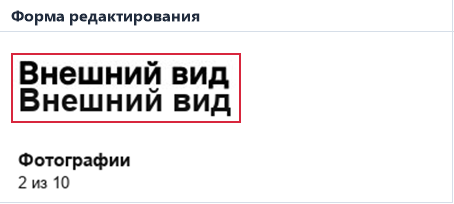</a></td>
</tr>
<tr>
  <td valign="top">Углы главной фотографии выступают за синюю рамку</td>
  <td align="center" valign="top">P3</td>
  <td valign="top">
<strong>Факт.</strong> У миниатюры с меткой "Главная" за скруглённой рамкой видны прямые углы изображения. Это заметно в верхнем левом углу на увеличенном фрагменте.

<strong>Ожидание.</strong> Углы миниатюры обрезаны по контуру рамки.
</td>
  <td valign="top"><a href="./task-1-images/qa-photo-corners.png">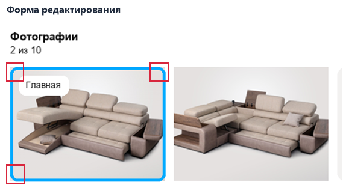</a> <a href="./task-1-images/qa-photo-corner-close.png">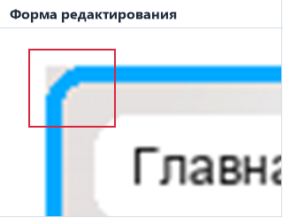</a></td>
</tr>
</tbody>
</table>

## Карточка продавца

[Оригинал скриншота](https://drive.google.com/file/d/1sRxQqr7mOjBcX9uMJ18GMT52onD6Tz7O/view?usp=sharing)

<table>
<thead>
<tr>
  <th width="146">Дефект</th>
  <th width="24">P</th>
  <th width="238">Фактический и ожидаемый результат</th>
  <th width="395">Скриншоты</th>
</tr>
</thead>
<tbody>
<tr>
  <td valign="top">Подменено название объявления</td>
  <td align="center" valign="top">P2</td>
  <td valign="top">
<strong>Факт.</strong> В заголовке "Диван прямой QA Sofa 2026 раскладной". В форме указано "угловой модульный".

<strong>Ожидание.</strong> Заголовок совпадает с полем "Название" в форме и отображается полностью: "Диван угловой модульный QA Sofa 2026 раскладной".
</td>
  <td valign="top"><a href="./task-1-images/qa-s01.png">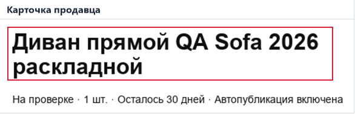</a> <a href="./task-1-images/qa-ref-title.png">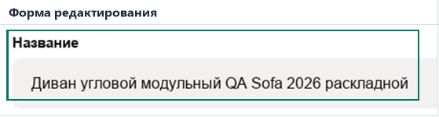</a></td>
</tr>
<tr>
  <td valign="top">На недельном графике нет данных при ненулевых просмотрах</td>
  <td align="center" valign="top">P2</td>
  <td valign="top">
<strong>Факт.</strong> На выбранной вкладке "Просмотры" показано 8. За период 10.08-16.08 на графике видны сетка и оси, значения по дням не отображаются.

<strong>Ожидание.</strong> График показывает распределение просмотров за выбранную неделю. Итог совпадает со счётчиком за тот же период и по тем же правилам подсчёта.
</td>
  <td valign="top"><a href="./task-1-images/qa-s02.png">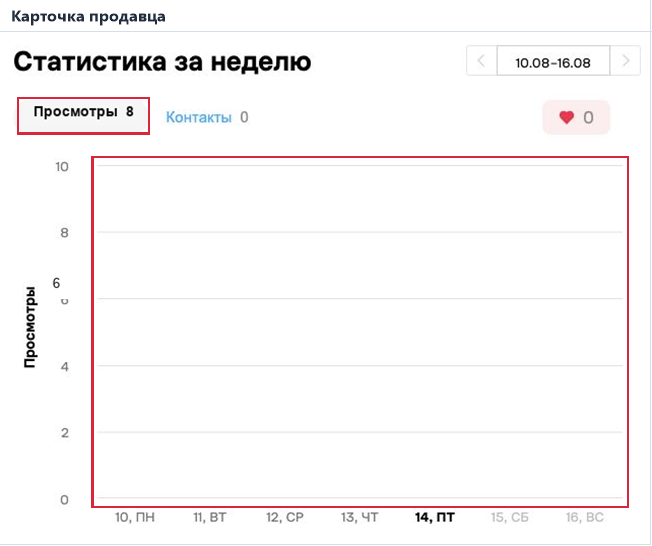</a></td>
</tr>
<tr>
  <td valign="top">Метка "6" на оси графика смещена, под ней виден обрезанный символ</td>
  <td align="center" valign="top">P3</td>
  <td valign="top">
<strong>Факт.</strong> У линии 6 видны смещённая цифра и фрагмент второй метки. Остальные подписи расположены напротив своих линий.

<strong>Ожидание.</strong> У каждой линии одна целая подпись, выровненная по линии.
</td>
  <td valign="top"><a href="./task-1-images/qa-s03.png">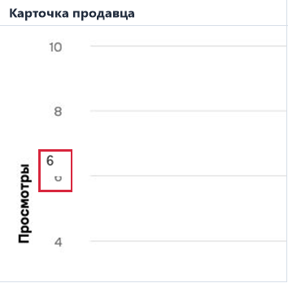</a></td>
</tr>
<tr>
  <td valign="top">Текст "Просмотры 8" смещён вверх внутри плашки</td>
  <td align="center" valign="top">P3</td>
  <td valign="top">
<strong>Факт.</strong> В блоке "Статистика за неделю" надпись "Просмотры 8" расположена примерно на 5 пикселей выше середины серой плашки.

<strong>Ожидание.</strong> Надпись выровнена по вертикали внутри плашки.
</td>
  <td valign="top"><a href="./task-1-images/qa-views-label.png">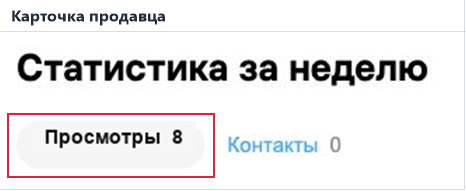</a></td>
</tr>
<tr>
  <td valign="top">Главная фотография оказалась второй в галерее</td>
  <td align="center" valign="top">P2</td>
  <td valign="top">
<strong>Факт.</strong> Первой выбрана фотография с поднятой деревянной панелью слева. Кадр с выдвинутым нижним ящиком стоит вторым, хотя в форме он отмечен как главный.

<strong>Ожидание.</strong> Фотография с меткой "Главная" расположена первой и открывается при первоначальном показе карточки.
</td>
  <td valign="top"><a href="./task-1-images/qa-s04.png">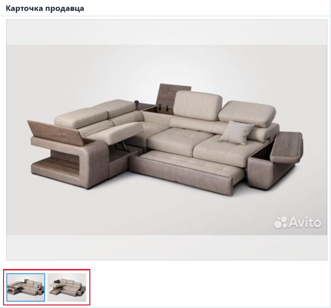</a> <a href="./task-1-images/qa-ref-photo.png">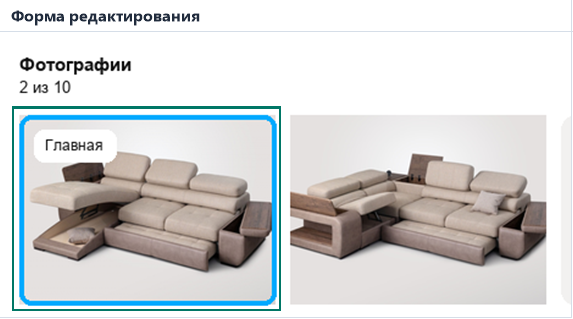</a></td>
</tr>
<tr>
  <td valign="top">В описание добавлен текст, которого нет в форме</td>
  <td align="center" valign="top">P2</td>
  <td valign="top">
<strong>Факт.</strong> К предложению про угловой раскладной диван добавлено "с ящиком для белья, подлокотниками и подушками".

<strong>Ожидание.</strong> Блок "Описание" передаёт текст из формы. Последнее предложение - "Угловой раскладной диван."
</td>
  <td valign="top"><a href="./task-1-images/qa-s05.png">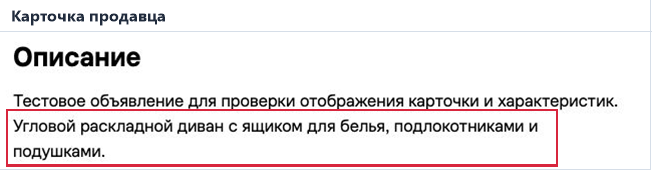</a> <a href="./task-1-images/qa-ref-desc.png">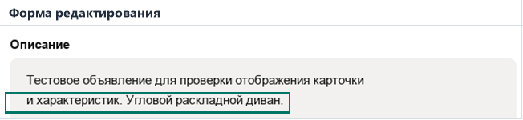</a></td>
</tr>
<tr>
  <td valign="top">В тексте акции использована форма "2,5 раз"</td>
  <td align="center" valign="top">P3</td>
  <td valign="top">
<strong>Факт.</strong> На плашке "Скидка на доставку" написано "До 2,5 раз больше шансов на продажу".

<strong>Ожидание.</strong> На плашке написано "До 2,5 раза больше шансов на продажу". После десятичной дроби используется форма "раза".
</td>
  <td valign="top"><a href="./task-1-images/qa-delivery-copy.png">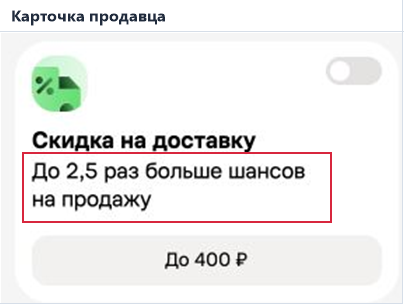</a></td>
</tr>
<tr>
  <td valign="top">В заголовке акции виден технический идентификатор</td>
  <td align="center" valign="top">P3</td>
  <td valign="top">
<strong>Факт.</strong> На плашке отображается "Скидки в test_sale_ops".

<strong>Ожидание.</strong> В заголовке отображается пользовательское название акции.
</td>
  <td valign="top"><a href="./task-1-images/qa-s06.png">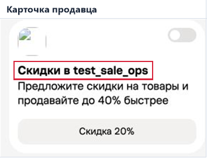</a></td>
</tr>
<tr>
  <td valign="top">Иконка на плашке со скидкой не отрисовалась</td>
  <td align="center" valign="top">P3</td>
  <td valign="top">
<strong>Факт.</strong> В верхней части плашки "Скидки в test_sale_ops" виден значок недоступного изображения.

<strong>Ожидание.</strong> Отображается иконка акции или предусмотренное оформление на случай отсутствия изображения.
</td>
  <td valign="top"><a href="./task-1-images/qa-s07.png">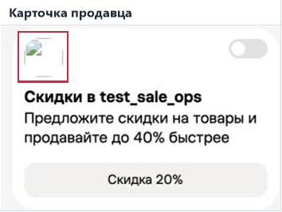</a></td>
</tr>
<tr>
  <td valign="top">Нижняя часть страницы повторяет верхнюю панель навигации</td>
  <td align="center" valign="top">P3</td>
  <td valign="top">
<strong>Факт.</strong> Под блоком "Распродажа" видны те же пункты "Для бизнеса", "Карьера в Авито", "Ещё" и "Разместить объявление", что в шапке. <em>Требует уточнения, где возник повтор.</em>

<strong>Ожидание.</strong> Верхняя панель отображается в предусмотренном месте. Для подтверждения повтора на странице нужно сверить её на стенде и проверить, как сделан длинный снимок.
</td>
  <td valign="top"><a href="./task-1-images/qa-s08.png">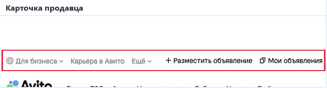</a> <a href="./task-1-images/qa-ref-seller-header.png">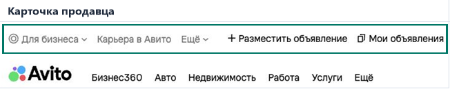</a></td>
</tr>
<tr>
  <td valign="top">Под раскрытыми заголовками нет содержимого</td>
  <td align="center" valign="top">P3</td>
  <td valign="top">
<strong>Факт.</strong> У блоков "Похожие объявления" и "Распродажа" стрелки направлены вверх, под обоими заголовками пусто. <em>Требует уточнения состояния блоков.</em>

<strong>Ожидание.</strong> Если стрелка вверх означает, что блок раскрыт, видны элементы или сообщение об их отсутствии. Блок без данных можно скрыть, если так предусмотрено дизайном.
</td>
  <td valign="top"><a href="./task-1-images/qa-s09.png">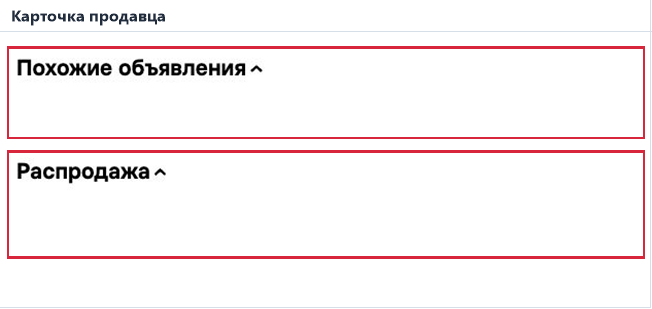</a></td>
</tr>
<tr>
  <td valign="top">В характеристиках отсутствуют модель и цвет производителя</td>
  <td align="center" valign="top">P3</td>
  <td valign="top">
<strong>Факт.</strong> В форме заполнены "Модель" и "Цвет от производителя". Этих строк в блоке "Характеристики" нет. Модель читается в заголовке объявления. <em>Требует уточнения состава блока.</em>

<strong>Ожидание.</strong> Если характеристики включают эти поля, в них отображаются "QA Sofa 2026" и "Графит".
</td>
  <td valign="top"><a href="./task-1-images/qa-s10.png">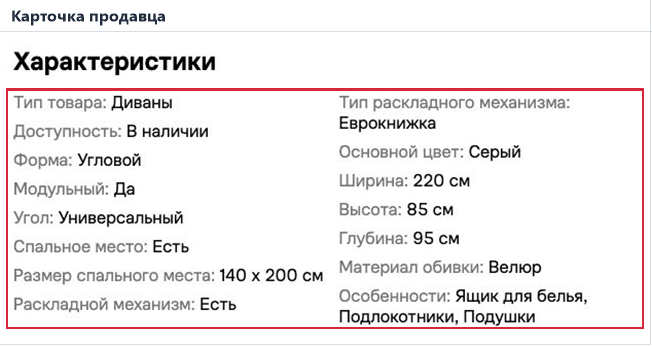</a> <a href="./task-1-images/qa-ref-model-color.png">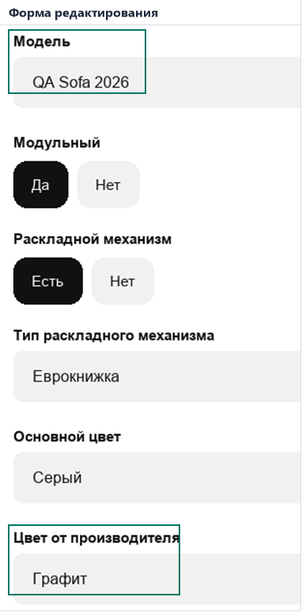</a></td>
</tr>
<tr>
  <td valign="top">Источник значений в поле "Особенности" неочевиден</td>
  <td align="center" valign="top">P3</td>
  <td valign="top">
<strong>Факт.</strong> В карточке перечислены ящик для белья, подлокотники и подушки. В показанной форме отдельного поля "Особенности" нет. <em>Требует уточнения источника данных.</em>

<strong>Ожидание.</strong> Если блок заполняется данными объявления, он показывает только указанные продавцом значения или значения из согласованного источника.
</td>
  <td valign="top"><a href="./task-1-images/qa-s11.png">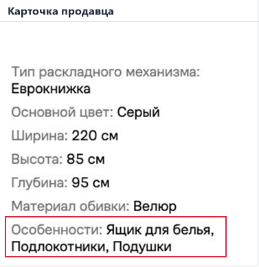</a></td>
</tr>
<tr>
  <td valign="top">В блоке о товаре отсутствует отметка "Б/у"</td>
  <td align="center" valign="top">P3</td>
  <td valign="top">
<strong>Факт.</strong> В форме выбрано "Б/у". В блоке "О диване" отображается только общее состояние "Отличное". <em>Требует уточнения правил отображения.</em>

<strong>Ожидание.</strong> Если карточка показывает оба признака, "Б/у" и "Отличное" отображаются как два отдельных значения.
</td>
  <td valign="top"><a href="./task-1-images/qa-s12.png">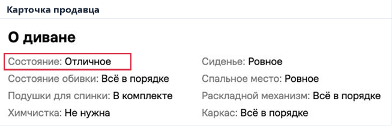</a> <a href="./task-1-images/qa-ref-used.png">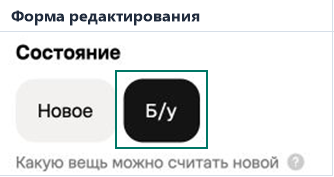</a></td>
</tr>
</tbody>
</table>

## Карточка товара

[Оригинал скриншота](https://drive.google.com/file/d/1mSG2furdRm9aLjt7tWKSXaD5iaWXyzgQ/view?usp=sharing)

<table>
<thead>
<tr>
  <th width="146">Дефект</th>
  <th width="24">P</th>
  <th width="238">Фактический и ожидаемый результат</th>
  <th width="395">Скриншоты</th>
</tr>
</thead>
<tbody>
<tr>
  <td valign="top">Цена завышена на 27 000 ₽</td>
  <td align="center" valign="top">P1</td>
  <td valign="top">
<strong>Факт.</strong> В карточке указано 52 000 ₽.

<strong>Ожидание.</strong> В карточке указано 25 000 ₽, как в форме редактирования.
</td>
  <td valign="top"><a href="./task-1-images/qa-i01.png">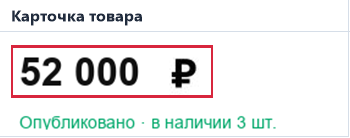</a> <a href="./task-1-images/qa-ref-price.png">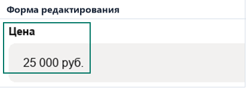</a></td>
</tr>
<tr>
  <td valign="top">Карточка сообщает, что продавец отключил включённую доставку</td>
  <td align="center" valign="top">P1</td>
  <td valign="top">
<strong>Факт.</strong> Блок показывает "Доставка недоступна" и пояснение "Продавец отключил доставку для объявления". В форме доставка включена, выбраны два способа отправки.

<strong>Ожидание.</strong> Карточка учитывает включённую доставку. Если она недоступна по другим условиям, блок показывает фактическую причину.
</td>
  <td valign="top"><a href="./task-1-images/qa-i02.png">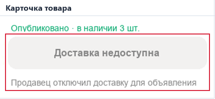</a> <a href="./task-1-images/qa-ref-delivery.png">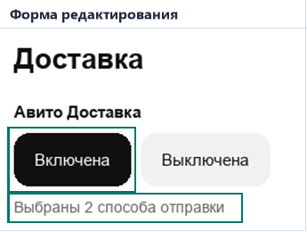</a></td>
</tr>
<tr>
  <td valign="top">В адресе указан неправильный номер дома</td>
  <td align="center" valign="top">P1</td>
  <td valign="top">
<strong>Факт.</strong> В карточке "Москва, пл. Революции, 5".

<strong>Ожидание.</strong> В карточке "Москва, пл. Революции, 3", как в форме.
</td>
  <td valign="top"><a href="./task-1-images/qa-i03.png">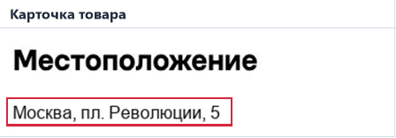</a> <a href="./task-1-images/qa-ref-place.png">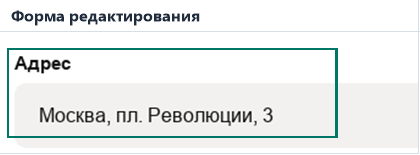</a></td>
</tr>
<tr>
  <td valign="top">Завышено количество товара в наличии</td>
  <td align="center" valign="top">P2</td>
  <td valign="top">
<strong>Факт.</strong> Рядом со статусом указано "в наличии 3 шт.".

<strong>Ожидание.</strong> Количество соответствует форме: "в наличии 1 шт.".
</td>
  <td valign="top"><a href="./task-1-images/qa-i04.png">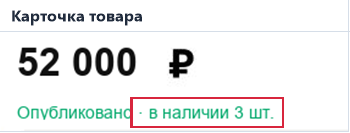</a> <a href="./task-1-images/qa-ref-qty.png">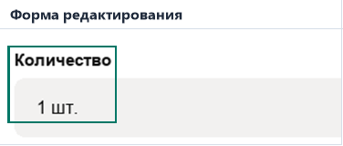</a></td>
</tr>
<tr>
  <td valign="top">Главная фотография оказалась второй в галерее</td>
  <td align="center" valign="top">P2</td>
  <td valign="top">
<strong>Факт.</strong> Первой выбрана фотография с поднятой деревянной панелью слева. Кадр с выдвинутым нижним ящиком стоит вторым. Аналогичное наблюдение в карточке продавца.

<strong>Ожидание.</strong> Фотография с меткой "Главная" расположена первой и открывается при первоначальном показе карточки.
</td>
  <td valign="top"><a href="./task-1-images/qa-i05.png">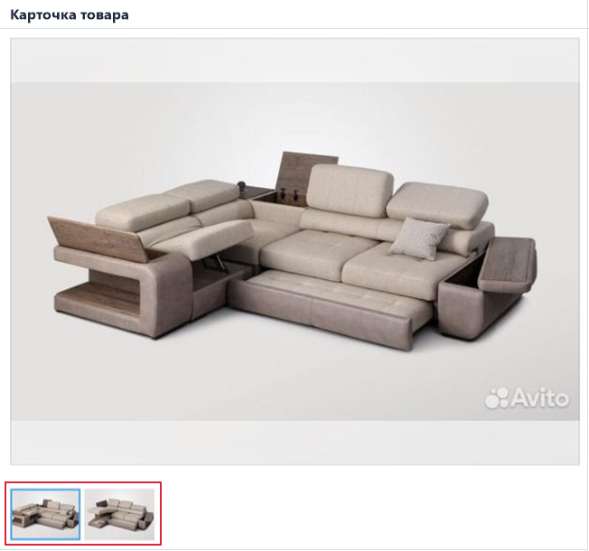</a> </td>
</tr>
<tr>
  <td valign="top">Характеристика "Форма" противоречит заголовку и форме редактирования</td>
  <td align="center" valign="top">P2</td>
  <td valign="top">
<strong>Факт.</strong> В характеристиках "Форма: Прямой" и "Угол: Универсальный". В заголовке товар назван угловым.

<strong>Ожидание.</strong> В характеристиках "Форма: Угловой". Значение "Универсальный" в поле "Угол" сохраняется.
</td>
  <td valign="top"><a href="./task-1-images/qa-i06.png">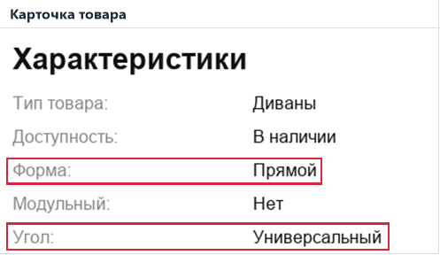</a> <a href="./task-1-images/qa-ref-shape.png">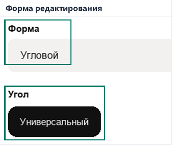</a></td>
</tr>
<tr>
  <td valign="top">Модульный диван помечен как немодульный</td>
  <td align="center" valign="top">P2</td>
  <td valign="top">
<strong>Факт.</strong> В характеристиках "Модульный: Нет". В заголовке диван назван модульным.

<strong>Ожидание.</strong> В характеристиках "Модульный: Да", как в форме.
</td>
  <td valign="top"><a href="./task-1-images/qa-i07.png">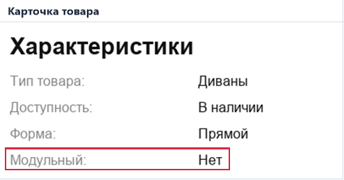</a> <a href="./task-1-images/qa-ref-modular.png">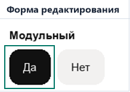</a></td>
</tr>
<tr>
  <td valign="top">Карточка отрицает наличие спального места и указывает его размер</td>
  <td align="center" valign="top">P2</td>
  <td valign="top">
<strong>Факт.</strong> В характеристиках "Спальное место: Нет" и "Размер спального места: 140 × 200 см".

<strong>Ожидание.</strong> В характеристиках "Спальное место: Есть" и размер 140 × 200 см, как в форме.
</td>
  <td valign="top"><a href="./task-1-images/qa-i08.png">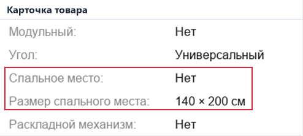</a> <a href="./task-1-images/qa-ref-bed.png">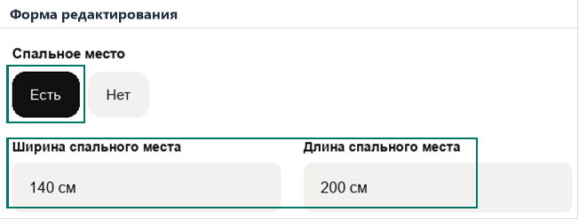</a></td>
</tr>
<tr>
  <td valign="top">Карточка отрицает наличие раскладного механизма и указывает его тип</td>
  <td align="center" valign="top">P2</td>
  <td valign="top">
<strong>Факт.</strong> В характеристиках "Раскладной механизм: Нет", в соседней колонке "Тип механизма: Еврокнижка".

<strong>Ожидание.</strong> В характеристиках "Раскладной механизм: Есть", тип - "Еврокнижка".
</td>
  <td valign="top"><a href="./task-1-images/qa-i09.png">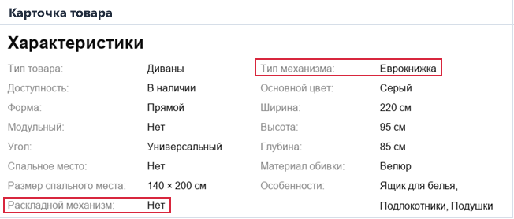</a> <a href="./task-1-images/qa-ref-mechanism.png">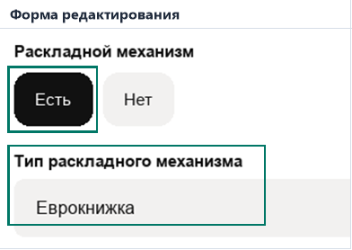</a></td>
</tr>
<tr>
  <td valign="top">Высота и глубина поменялись местами</td>
  <td align="center" valign="top">P2</td>
  <td valign="top">
<strong>Факт.</strong> Высота - 95 см, глубина - 85 см.

<strong>Ожидание.</strong> Высота - 85 см, глубина - 95 см. Значение каждой величины соответствует своему полю в форме.
</td>
  <td valign="top"><a href="./task-1-images/qa-i10.png">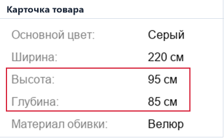</a> <a href="./task-1-images/qa-ref-size.png">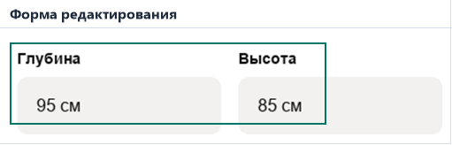</a></td>
</tr>
<tr>
  <td valign="top">Обивка ошибочно отмечена как требующая замены</td>
  <td align="center" valign="top">P2</td>
  <td valign="top">
<strong>Факт.</strong> В блоке "О диване" указано "Состояние обивки: Требует замены".

<strong>Ожидание.</strong> Отображается "Состояние обивки: Всё в порядке".
</td>
  <td valign="top"><a href="./task-1-images/qa-i11.png">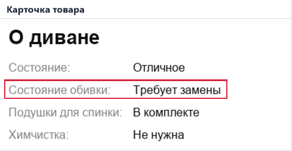</a> <a href="./task-1-images/qa-ref-upholstery.png">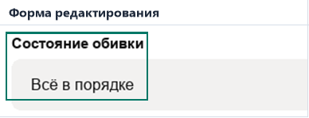</a></td>
</tr>
<tr>
  <td valign="top">Раскладной механизм ошибочно отмечен как требующий ремонта</td>
  <td align="center" valign="top">P2</td>
  <td valign="top">
<strong>Факт.</strong> В блоке "О диване" указано "Раскладной механизм: Требуется ремонт".

<strong>Ожидание.</strong> Отображается "Раскладной механизм: Всё в порядке".
</td>
  <td valign="top"><a href="./task-1-images/qa-i12.png">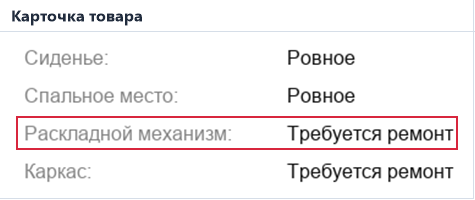</a> <a href="./task-1-images/qa-ref-condition-mechanism.png">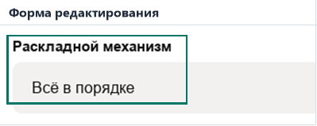</a></td>
</tr>
<tr>
  <td valign="top">Каркас ошибочно отмечен как требующий ремонта</td>
  <td align="center" valign="top">P2</td>
  <td valign="top">
<strong>Факт.</strong> В блоке "О диване" указано "Каркас: Требуется ремонт".

<strong>Ожидание.</strong> Отображается "Каркас: Всё в порядке".
</td>
  <td valign="top"><a href="./task-1-images/qa-i13.png">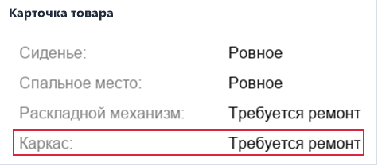</a> <a href="./task-1-images/qa-ref-frame.png">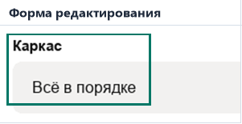</a></td>
</tr>
<tr>
  <td valign="top">В заголовке "Описание" срезан верх буквы "О"</td>
  <td align="center" valign="top">P3</td>
  <td valign="top">
<strong>Факт.</strong> В карточке товара верхний контур буквы "О" обрезан. В карточке продавца та же буква в заголовке видна целиком.

<strong>Ожидание.</strong> Заголовок отображается целиком, включая верхний контур буквы "О".
</td>
  <td valign="top"><a href="./task-1-images/qa-description-heading.png">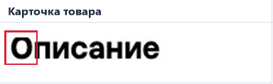</a> <a href="./task-1-images/qa-ref-description-heading.png">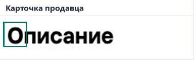</a></td>
</tr>
<tr>
  <td valign="top">В описание добавлен текст, которого нет в форме</td>
  <td align="center" valign="top">P2</td>
  <td valign="top">
<strong>Факт.</strong> К предложению про диван дописано "с ящиком для белья, подлокотниками и подушками". Аналогичное наблюдение в карточке продавца.

<strong>Ожидание.</strong> Блок "Описание" показывает текст из формы. Последнее предложение - "Угловой раскладной диван."
</td>
  <td valign="top"> </td>
</tr>
<tr>
  <td valign="top">В карточке покупателя показана общая подпись вместо имени продавца</td>
  <td align="center" valign="top">P2</td>
  <td valign="top">
<strong>Факт.</strong> На карточке товара продавец подписан "Пользователь", в карточке продавца - "Гедеоныч". <em>Требует уточнения правил для гостя.</em>

<strong>Ожидание.</strong> Если имя публично для гостя, в карточке отображается "Гедеоныч".
</td>
  <td valign="top"> </td>
</tr>
<tr>
  <td valign="top">Статус объявления расходится между карточками</td>
  <td align="center" valign="top">P2</td>
  <td valign="top">
<strong>Факт.</strong> Карточка товара показывает "Опубликовано". В карточке продавца объявления № 52291995943 указано "На проверке". <em>Требует сверки времени и правил модерации.</em>

<strong>Ожидание.</strong> При одновременной проверке обе карточки отражают актуальное состояние объявления. Если изменения проходят модерацию при доступной опубликованной версии, статус продавца поясняет, что проверяется новая версия.
</td>
  <td valign="top"> </td>
</tr>
<tr>
  <td valign="top">Публичный счётчик просмотров показывает ноль при ненулевой статистике продавца</td>
  <td align="center" valign="top">P2</td>
  <td valign="top">
<strong>Факт.</strong> У объявления № 52291995943 указано "0 просмотров (+0 сегодня)". В статистике продавца за 10.08-16.08 - 8 просмотров. <em>Требует сверки правил подсчёта и времени обновления.</em>

<strong>Ожидание.</strong> При одинаковых правилах подсчёта и синхронных данных общий счётчик учитывает просмотры за прошедшую часть этой недели.
</td>
  <td valign="top"> </td>
</tr>
<tr>
  <td valign="top">Подсказка предлагает спросить о доставке, которая помечена как недоступная</td>
  <td align="center" valign="top">P3</td>
  <td valign="top">
<strong>Факт.</strong> Под полем вопроса есть кнопка "Отправите Авито Доставкой?". Выше та же карточка сообщает, что продавец отключил доставку. <em>Требует уточнения логики подсказок.</em>

<strong>Ожидание.</strong> Если подсказки зависят от доступных способов получения, вопрос о доставке появляется при релевантном для него состоянии.
</td>
  <td valign="top"> </td>
</tr>
<tr>
  <td valign="top">У баннера "Найти своё на ресейле" отсутствует иллюстрация</td>
  <td align="center" valign="top">P3</td>
  <td valign="top">
<strong>Факт.</strong> В правом нижнем углу баннера видны значок недоступного изображения и текст "Ресейл".

<strong>Ожидание.</strong> Баннер показывает иллюстрацию или предусмотренное оформление на случай её отсутствия.
</td>
  <td valign="top"></td>
</tr>
<tr>
  <td valign="top">После подвала повторяется верхняя панель навигации</td>
  <td align="center" valign="top">P3</td>
  <td valign="top">
<strong>Факт.</strong> Под ссылками подвала снова видны верхнее меню, логотип и начало поисковой строки. <em>Требует уточнения, где возник повтор.</em>

<strong>Ожидание.</strong> Верхняя панель отображается в предусмотренном месте. Для подтверждения повтора на странице нужно сверить её на стенде и проверить, как сделан длинный снимок.
</td>
  <td valign="top"> </td>
</tr>
<tr>
  <td valign="top">В характеристиках отсутствуют модель и цвет производителя</td>
  <td align="center" valign="top">P3</td>
  <td valign="top">
<strong>Факт.</strong> В блоке есть "Основной цвет: Серый". Строк с моделью и цветом от производителя нет. Модель читается в заголовке объявления. <em>Требует уточнения состава блока.</em>

<strong>Ожидание.</strong> Если характеристики включают эти поля, в них отображаются "QA Sofa 2026" и "Графит".
</td>
  <td valign="top"> </td>
</tr>
<tr>
  <td valign="top">Источник значений в поле "Особенности" неочевиден</td>
  <td align="center" valign="top">P3</td>
  <td valign="top">
<strong>Факт.</strong> В карточке перечислены ящик для белья, подлокотники и подушки. В показанной форме отдельного поля "Особенности" нет. Такое же наблюдение в карточке продавца. <em>Требует уточнения источника данных.</em>

<strong>Ожидание.</strong> Если блок заполняется данными объявления, он показывает только указанные продавцом значения или значения из согласованного источника.
</td>
  <td valign="top"></td>
</tr>
<tr>
  <td valign="top">В блоке о товаре отсутствует отметка "Б/у"</td>
  <td align="center" valign="top">P2</td>
  <td valign="top">
<strong>Факт.</strong> Покупатель видит "Состояние: Отличное", а выбранное в форме "Б/у" в блоке отсутствует. <em>Требует уточнения правил отображения.</em>

<strong>Ожидание.</strong> Если оба признака предназначены для покупателя, карточка показывает "Б/у" и отдельно общее состояние "Отличное".
</td>
  <td valign="top"> </td>
</tr>
<tr>
  <td valign="top">В нижней ссылке лишняя заглавная буква</td>
  <td align="center" valign="top">P3</td>
  <td valign="top">
<strong>Факт.</strong> Рядом с подвалом ссылка "Модульные Диваны в Москве".

<strong>Ожидание.</strong> В ссылке "Модульные диваны в Москве".
</td>
  <td valign="top"></td>
</tr>
<tr>
  <td valign="top">В цене увеличен интервал перед символом рубля</td>
  <td align="center" valign="top">P3</td>
  <td valign="top">
<strong>Факт.</strong> В карточке товара между суммой и символом ₽ заметно больше места, чем в аналогичном ценовом блоке карточки продавца. <em>Требует сверки с макетом.</em>

<strong>Ожидание.</strong> Сумма и обозначение валюты оформлены единообразно по правилам отображения цены.
</td>
  <td valign="top"> </td>
</tr>
</tbody>
</table>
